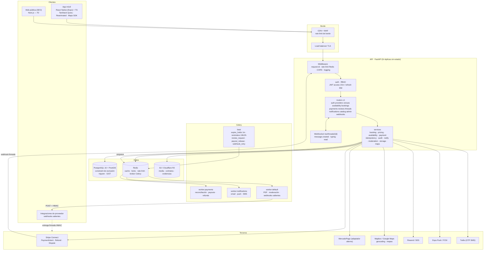
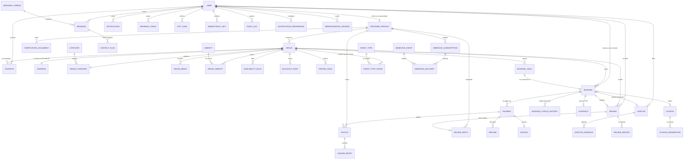
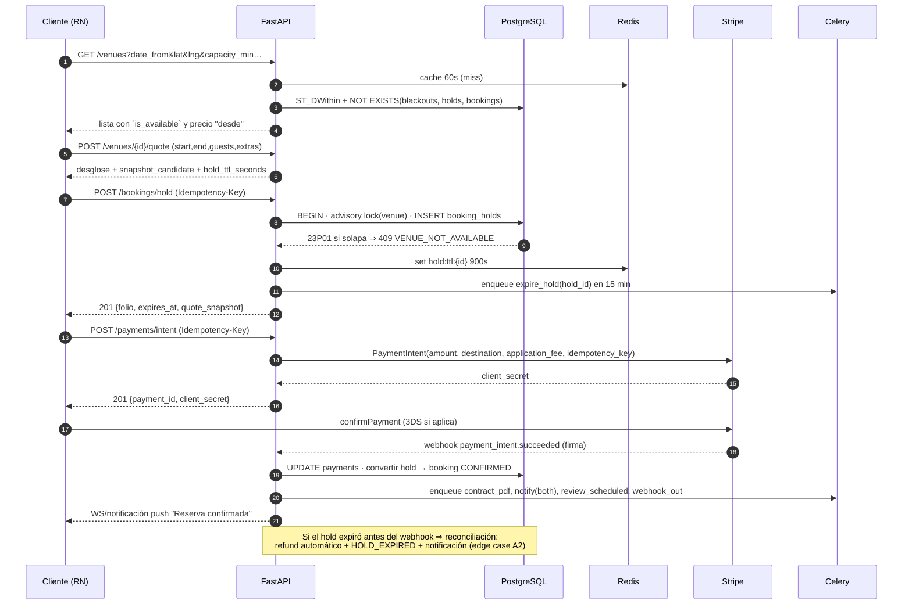

# 02 · Arquitectura y modelo de datos

## 2.1 Diagrama de arquitectura



### Capas del backend

| Capa | Carpeta | Regla |
|---|---|---|
| Transporte | `app/api/v1/*.py` | Sólo HTTP: valida Pydantic, resuelve usuario, llama a un servicio. Sin SQL. |
| Dependencias | `app/api/deps.py` | `get_current_user`, `require_roles`, `require_idempotency`, `get_db` |
| Dominio | `app/services/*.py` | Reglas de negocio, transacciones, máquina de estados. Sin `Request`. |
| Persistencia | `app/models/*`, `app/db/*` | SQLAlchemy 2.0 async, `Mapped[]`, `mapped_column` |
| Trabajo asíncrono | `app/tasks/*` | Celery, idempotente, con locks `FOR UPDATE SKIP LOCKED` |
| Infra | `app/core/*` | config, seguridad, errores, redis, rate limit, logging, paginación |

## 2.2 Modelo entidad-relación



### Entidades y propósito

| Entidad | Tabla | Notas de diseño |
|---|---|---|
| `User` | `users` | Rol enum; `pii_erased_at` para anonimización; `email_normalized` (alias `+` colapsado, C16) |
| `RefreshToken` | `refresh_tokens` | Rotación con `jti` + `family_id`; reutilización ⇒ revoca familia |
| `OtpCode` | `otp_codes` | Hash del código, `attempts`, `expires_at`, canal (`sms`/`email`) |
| `ProviderProfile` | `provider_profiles` | `status` (DRAFT/PENDING/APPROVED/REJECTED/SUSPENDED), `payouts_enabled`, `instant_book` |
| `VerificationDocument` | `verification_documents` | Tipo (INE, acta, CSF, comprobante domicilio), `status`, `reviewed_by`, hash de archivo |
| `Venue` | `venues` | `timezone` IANA, `capacity`, `min_hours`, `buffer_minutes`, `instant_book`, `status`, `search_vector` |
| `Address` | `addresses` | `geography(Point,4326)`, `geocoded_at`, `pin_adjusted` (C21), colonia/municipio/estado/CP |
| `VenueMedia` | `venue_media` | `sort_order`, `kind` (photo/video/floorplan), `moderation_status`, `width/height/blurhash` |
| `Category` / `VenueCategory` | `categories`, `venue_categories` | Categorías jerárquicas, soft-delete con migración (D24) |
| `Amenity` / `VenueAmenity` | `amenities`, `venue_amenities` | `is_free`, `extra_cents` (se cobra como extra en cotización) |
| `EventType` / `EventTypeVenue` | `event_types`, `event_type_venues` | XV años, boda, cumpleaños, corporativo… |
| `AvailabilityRule` | `availability_rules` | `weekday`, `open_time`, `close_time`, `slot_minutes`, `valid_from/to`, `crosses_midnight` |
| `BlackoutDate` | `blackout_dates` | Rango UTC + motivo; `is_partial` para cierre parcial |
| `PricingRule` | `pricing_rules` | `kind` (BASE/SEASON/HOLIDAY/WEEKEND/LAST_MINUTE), `amount_cents`, prioridad, `min_guests`, `valid_from/to` |
| `BookingHold` | `booking_holds` | `expires_at`, `quote_snapshot` JSONB, `status`, folio `HD-*`; **constraint de exclusión** |
| `Booking` | `bookings` | `state`, `total_cents`, `deposit_cents`, `quote_snapshot`, `rules_snapshot`, `check_in_at/out_at`, `folio`; **constraint de exclusión** |
| `BookingStatusHistory` | `booking_status_history` | `from_state`, `to_state`, `actor_id`, `reason`, `at` — toda transición |
| `Payment` | `payments` | `kind` (FULL/DEPOSIT/BALANCE), `provider` (stripe/mercadopago), `provider_intent_id`, `status`, `is_deposit` |
| `Refund` | `refunds` | `amount_cents`, `tier_applied` (100/50/0), `reason`, `provider_refund_id`, `status` |
| `Payout` | `payouts` | `period_start/end`, `gross_cents`, `fee_cents`, `net_cents`, `status`, `frozen_reason` (disputa) |
| `LedgerEntry` | `ledger_entries` | Doble partida mínima: DEBIT/CREDIT por booking/payment/payout |
| `Invoice` | `invoices` | `uuid_fiscal`, `rfc`, `cfdi_status` (pendiente/timbrado), XML en R2 |
| `Dispute` | `disputes` | `kind` (CHARGEBACK/CLAIM/DAMAGE), `status`, `deadline_at`, `frozen_payout_id` |
| `DisputeEvidence` | `dispute_evidence` | Archivos + notas; hash y autor |
| `Review` | `reviews` | `rating`, `subratings` JSONB, `status` (PUBLISHED/HIDDEN/PENDING), `verified_booking_id` |
| `ReviewReply` | `review_replies` | Una por reseña, editable 72 h |
| `ReviewReport` | `review_reports` | Motivo + resolución admin (C17) |
| `MessageThread` | `message_threads` | Por (booking | venue+cliente), `last_message_at`, `client_unread`/`provider_unread` |
| `Message` | `messages` | `body`, `attachments`, `read_at`, `moderation_status`, `bypass_score` |
| `ContactFlag` | `contact_flags` | Detecta teléfono/email/redes; `action` (WARN/REVIEW/BLOCK) — revisión humana antes de bloquear (C19) |
| `Notification` | `notifications` | `kind`, `payload` JSONB, `read_at`, canal por preferencia |
| `NotificationPreference` | `notification_preferences` | Matriz evento × canal (push/email/sms/whatsapp) |
| `Coupon` | `coupons` | `code`, `kind` (PERCENT/FIXED), `max_redemptions`, `per_user_limit`, `venue_ids[]`, `valid_from/to` |
| `CouponRedemption` | `coupon_redemptions` | Unicidad (coupon, user, booking) para evitar doble descuento (B13) |
| `AuditLog` | `audit_logs` | `actor_id`, `action`, `entity`, `entity_id`, `before`, `after`, `ip`, `request_id` |
| `IdempotencyKey` | `idempotency_keys` | `(user_id, endpoint, key)` único, `request_hash`, `response_body`, `status` |
| `WebhookEvent` | `webhook_events` | Evento interno persistido antes de entregar; `replay_count` |
| `WebhookSubscription` | `webhook_subscriptions` | `url`, `secret`, `events[]`, `is_active`, `failure_count` |
| `WebhookDelivery` | `webhook_deliveries` | Intento: `attempt`, `status_code`, `response_body`, `next_retry_at` |
| `ImpersonationSession` | `impersonation_sessions` | Admin ↔ usuario, TTL 30 min, motivo, auditado |

### Invariantes (se verifican en DB, no en código)

```sql
-- 1) Nunca dos reservas solapadas en el mismo venue
ALTER TABLE bookings ADD CONSTRAINT bookings_no_overlap
  EXCLUDE USING gist (
    venue_id WITH =,
    tstzrange(start_at, end_at, '[)') WITH &&
  ) WHERE (state IN ('HOLD','PENDING_PAYMENT','CONFIRMED','COMPLETED'));

-- 2) Lo mismo para apartados
ALTER TABLE booking_holds ADD CONSTRAINT holds_no_overlap
  EXCLUDE USING gist (venue_id WITH =, tstzrange(start_at, end_at, '[)') WITH &&)
  WHERE (status = 'ACTIVE');

-- 3) El hold y el booking no pueden coexistir solapados: se cubre porque la
--    conversión borra el hold en la misma transacción (ADR-003) y ambas
--    constraints comparten venue_id + rango.

-- 4) Dinero no negativo y coherente
ALTER TABLE bookings ADD CONSTRAINT bookings_amounts_ck
  CHECK (total_cents >= 0 AND deposit_cents >= 0 AND deposit_cents <= total_cents);

-- 5) Un reseña por reserva completada
CREATE UNIQUE INDEX reviews_one_per_booking ON reviews (booking_id) WHERE deleted_at IS NULL;

-- 6) Un canje de cupón por usuario y reserva
CREATE UNIQUE INDEX coupon_once ON coupon_redemptions (coupon_id, user_id, booking_id);
```

## 2.3 Flujo crítico: de la búsqueda a la reserva



## 2.4 Despliegue y entornos

| Entorno | API | DB | Redis | Objetos | Pagos |
|---|---|---|---|---|---|
| dev | uvicorn local | docker postgres:16-postgis | docker | MinIO | Stripe test + `stripe listen` |
| staging | 2 réplicas | RDS db.t4g.small | ElastiCache | R2 bucket staging | Stripe test, webhooks reales |
| prod | 3+ réplicas HPA | RDS Multi-AZ + réplica lectura | ElastiCache cluster | R2 + CDN | Stripe live |

- **Migraciones**: Alembic en un job previo al rollout (`alembic upgrade head`), nunca en el arranque de
  las réplicas. Las migraciones que añaden índices GiST usan `CREATE INDEX CONCURRENTLY`.
- **Observabilidad**: OpenTelemetry → logs JSON con `request_id`, `user_id`, `booking_id`; métricas
  Prometheus (`http_request_duration_seconds`, `booking_hold_conflicts_total`,
  `celery_task_failures_total`, `payment_webhook_lag_seconds`); alertas por SLO.
- **Feature flags** en Redis (`flags:instant_book`, `flags:mercadopago`) para desactivar proveedores
  degradados (F31) sin desplegar.
