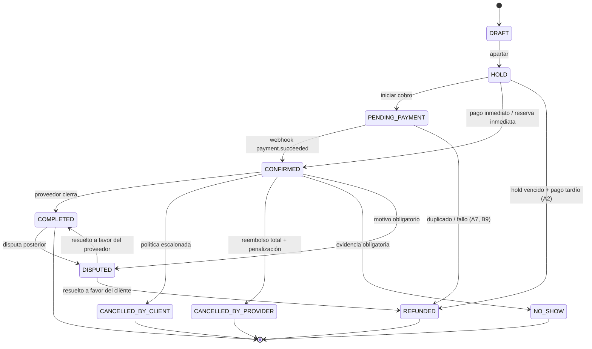

# 05 · Máquina de estados de Booking

Fuente de verdad ejecutable: [`backend/app/services/state_machine.py`](../backend/app/services/state_machine.py).
Toda transición pasa por `assert_transition()` y deja rastro en `booking_status_history` + `audit_logs`.
`allowed_transitions(state, actor)` alimenta los botones de la UI: la app **no** inventa acciones.

## 5.1 Estados

| Estado | ¿Ocupa el calendario? | ¿Terminal? | Significado |
|---|---|---|---|
| `DRAFT` | no | no | Borrador del cliente antes de apartar |
| `HOLD` | **sí** | no | Apartado con TTL y precio congelado |
| `PENDING_PAYMENT` | **sí** | no | Se inició el cobro; el slot sigue reservado |
| `CONFIRMED` | **sí** | no | Reserva en firme, contrato emitido |
| `COMPLETED` | **sí** | no | Evento realizado y cerrado |
| `CANCELLED_BY_CLIENT` | no | sí | El cliente canceló (política escalonada aplicada) |
| `CANCELLED_BY_PROVIDER` | no | sí | El anfitrión canceló (reembolso total + penalización) |
| `NO_SHOW` | no | sí | El cliente no llegó; evidencia obligatoria |
| `REFUNDED` | no | sí | Reembolso total (hold vencido con pago tardío, resolución de disputa) |
| `DISPUTED` | sí (congela payout) | no | Disputa abierta |

> Los cuatro estados que ocupan calendario coinciden exactamente con la cláusula `WHERE` de la
> constraint `bookings_no_overlap`. Hay una prueba que compara ambos conjuntos
> (`test_estados_que_ocupan_calendario`), de modo que no pueden divergir en silencio.

## 5.2 Tabla de transiciones válidas

| Desde | Hacia | Actores | Guardas | Efectos |
|---|---|---|---|---|
| `DRAFT` | `HOLD` | CLIENT, SYSTEM | fecha futura | `reserve_slot`, `start_hold_ttl` |
| `DRAFT` | `CANCELLED_BY_CLIENT` | CLIENT, SYSTEM | — | — |
| `HOLD` | `PENDING_PAYMENT` | CLIENT, SYSTEM | — | `freeze_quote`, `create_payment_intent` |
| `HOLD` | `CONFIRMED` | CLIENT, PROVIDER, SYSTEM | — | `confirm_slot`, `notify_both`, `schedule_reminders`, `emit_webhook` |
| `HOLD` | `CANCELLED_BY_CLIENT` | CLIENT, ADMIN, SYSTEM | — | `release_slot`, `apply_refund_policy`, `notify_provider` |
| `HOLD` | `CANCELLED_BY_PROVIDER` | PROVIDER, ADMIN, SYSTEM | — | `release_slot`, `full_refund`, `penalize_provider` |
| `HOLD` | `REFUNDED` | ADMIN, SYSTEM | — | `full_refund` (pago tardío, A2) |
| `PENDING_PAYMENT` | `CONFIRMED` | CLIENT, PROVIDER, SYSTEM | — | confirmación por webhook |
| `PENDING_PAYMENT` | `CANCELLED_BY_CLIENT` / `_BY_PROVIDER` | CLIENT / PROVIDER, ADMIN | — | libera slot + política / reembolso total |
| `PENDING_PAYMENT` | `REFUNDED` | ADMIN, SYSTEM | — | pago duplicado o fallo (A7, B9) |
| `CONFIRMED` | `COMPLETED` | PROVIDER, ADMIN, SYSTEM | — | `release_security_deposit`, `request_review`, `accrue_payout`, `emit_webhook` |
| `CONFIRMED` | `CANCELLED_BY_CLIENT` | CLIENT, ADMIN, SYSTEM | **evento no iniciado** | `apply_refund_policy` |
| `CONFIRMED` | `CANCELLED_BY_PROVIDER` | PROVIDER, ADMIN, SYSTEM | — | `full_refund`, `penalize_provider`, `offer_alternatives` |
| `CONFIRMED` | `NO_SHOW` | PROVIDER, ADMIN | **evidencia**, evento iniciado | `retain_deposit`, `flag_client_risk` |
| `CONFIRMED` | `DISPUTED` | CLIENT, PROVIDER, ADMIN | **motivo ≥ 5 chars** | `freeze_payout`, `open_dispute` |
| `CONFIRMED` | `REFUNDED` | ADMIN, SYSTEM | — | `full_refund` |
| `COMPLETED` | `DISPUTED` | CLIENT, PROVIDER, ADMIN | motivo | disputa posterior (daños) |
| `COMPLETED` | `REFUNDED` | ADMIN | — | reembolso de buena voluntad |
| `DISPUTED` | `COMPLETED` | ADMIN | — | `unfreeze_payout`, `resolve_dispute` |
| `DISPUTED` | `REFUNDED` | ADMIN | — | reembolso + ajuste de payout |
| `DISPUTED` | `CANCELLED_BY_*` | ADMIN | — | libera slot |

Estados terminales sin salida: `CANCELLED_BY_CLIENT`, `CANCELLED_BY_PROVIDER`, `NO_SHOW`, `REFUNDED`.

## 5.3 Guardas (implementación)

| Guarda | Regla | Código/mensaje |
|---|---|---|
| `_guard_future` | No se cancela ni aparta lo que ya empezó | `INVALID_STATE_TRANSITION` · «El evento ya comenzó: usa check-in, no-show o disputa» |
| `_guard_checkin_window` | Check-in sólo dentro de `checkin_window_minutes` (120) | `CHECK_IN_NOT_ALLOWED_YET` |
| `_guard_evidence` | No-show exige al menos una evidencia | `VALIDATION_ERROR` · «Se requiere al menos una evidencia» |
| `_guard_reason` | Disputa exige motivo ≥ 5 caracteres | `INVALID_STATE_TRANSITION` |
| `_guard_actor` | Sólo los actores declarados | `FORBIDDEN` |
| Repetir el mismo estado | No es error destructivo: 200 con `idempotent: true` | Se audita como `idempotent_replay` |

## 5.4 Actores y RBAC

`actor_from_role(role, is_owner, is_provider)` traduce el rol autenticado al actor del dominio.
**Nunca** se deriva del `user_id` que manda el cliente: el servicio carga la reserva y compara
`client_id` / `provider_id` contra el usuario del JWT (ver `_get_booking_for_actor`).

| Actor | Puede |
|---|---|
| `CLIENT` | apartar, pagar, cancelar (con política), reprogramar, disputar, reseñar |
| `PROVIDER` | aprobar/rechazar apartado, completar, no-show con evidencia, cancelar (reembolso total), responder reseñas |
| `ADMIN`/`SUPPORT` | resolver disputas, reembolsar fuera de política, suspender, impersonar (auditado) |
| `SYSTEM` | webhooks, jobs (expiración de holds, reconciliación de pagos) |

## 5.5 Diagrama

## 5.6 Idempotencia de transiciones

| Escenario | Resultado |
|---|---|
| Reintento de la misma transición (mismo estado destino) | 200, `idempotent_replay=true` en el historial; no se duplican efectos |
| Webhook repetido | `payment.metadata_json.applied_events` bloquea la segunda aplicación |
| Job `expire_holds` ejecutado dos veces | Sólo toca holds `ACTIVE`; el segundo pase no encuentra nada |
| `POST /bookings` con la misma `Idempotency-Key` | Devuelve el booking ya creado |
| Conversión de hold ya convertido | Devuelve el booking existente (`HOLD_ALREADY_CONVERTED` sólo si no se encuentra) |
