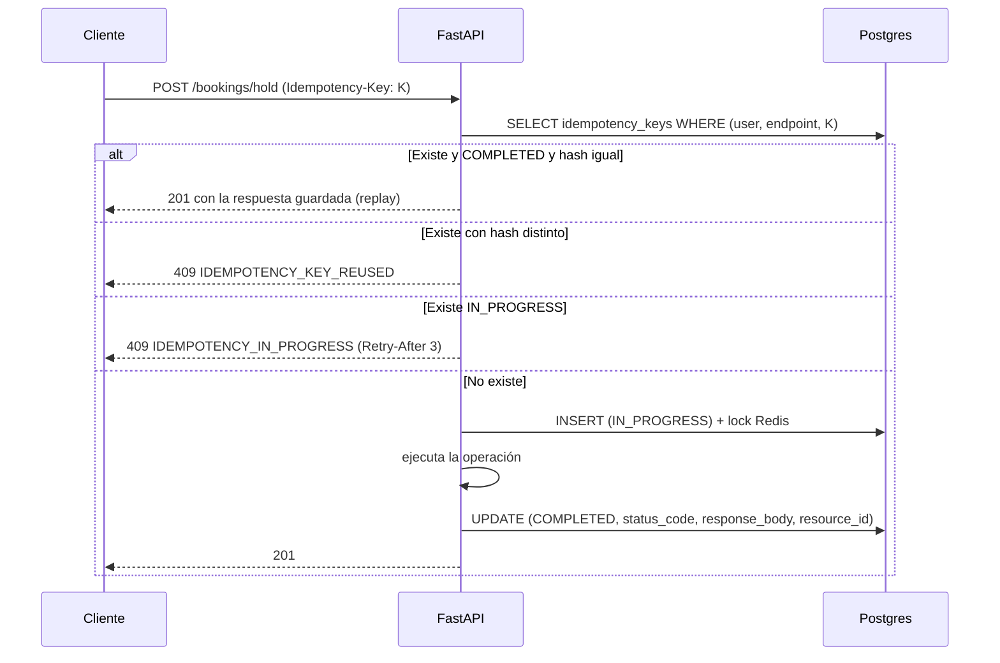

# 06 · Idempotencia, webhooks y colas Celery

## 6.1 Idempotencia (ADR-005)

Implementación: [`backend/app/services/idempotency.py`](../backend/app/services/idempotency.py).

| Aspecto | Decisión |
|---|---|
| Almacén | Tabla `idempotency_keys` (durable), no sólo Redis |
| Alcance | `UNIQUE(user_id, endpoint, key)` — la misma llave en otro endpoint es otra operación |
| Huella | `sha256(endpoint + body_canónico)`; el orden de las claves no importa |
| Lock corto | `SET NX PX 20s` en Redis; la fila `IN_PROGRESS` es la garantía |
| Misma llave + mismo body | Se devuelve la **respuesta guardada** (`idempotent_replay: true`) |
| Misma llave + body distinto | `409 IDEMPOTENCY_KEY_REUSED` con `hint` |
| Ejecución en curso | `409 IDEMPOTENCY_IN_PROGRESS` + `Retry-After: 3` |
| Fallo durante la ejecución | La llave se marca `FAILED` y **se libera**: el reintento puede volver a intentarlo |
| TTL | 30 días; job diario `cleanup_idempotency_keys` |
| Longitud máxima | 120 caracteres |

Endpoints que la exigen: `POST /bookings/hold`, `POST /bookings`, `POST /payments/intent`,
`POST /refunds`, `POST /admin/payouts/{id}/release`, `POST /admin/impersonate`.

Flujo:



## 6.2 Webhooks entrantes (PSP → Quinta)

| Regla | Detalle |
|---|---|
| Firma obligatoria | `stripe.Webhook.construct_event` (Stripe) o HMAC `ts.v1` (MercadoPago). Sin firma: 400 y **no se toca la BD** |
| Ruta | `POST /api/v1/payments/webhook` — exenta de rate limit (la firma es la defensa) |
| Idempotencia | `payment.metadata_json.applied_events` guarda los últimos 20 `event_id`; el repetido responde 200 `duplicated: true` |
| Desorden | Se normaliza el tipo (`payment_intent.succeeded` → `payment.succeeded`) y se aplica por estado final: `succeeded` gana a `failed`; un evento más viejo no revierte un estado terminal |
| Reconciliación | Hold vencido + pago exitoso ⇒ `REFUNDED` + encolado de `reconcile_expired_hold_payment` (A2) |
| Barrido | `reconcile_orphan_payments` cada 10 min revisa pagos cobrados sin estado final |
| Respuesta | Siempre 200 si se procesó o ya estaba aplicado; 4xx sólo por firma inválida o payload ilegible |

## 6.3 Webhooks salientes (Quinta → proveedores)

Implementación: [`backend/app/services/webhooks_out.py`](../backend/app/services/webhooks_out.py).

```http
POST https://crm.palapaxcambo.mx/quinta
Content-Type: application/json
X-Quinta-Signature: t=1767200000,v1=6c4f...b2
X-Quinta-Event: booking.confirmed
X-Quinta-Event-Id: 9f2c41ab-...
X-Quinta-Delivery-Attempt: 2
```
```json
{
  "id": "9f2c41ab-7d5e-3c10-8a4b-1e2d3c4b5a69",
  "type": "booking.confirmed",
  "created_at": "2026-10-01T18:00:00+00:00",
  "api_version": "2026-01-15",
  "data": { "booking_id": "b71c9a4e-...", "folio": "QX-4F2A91", "total_cents": 1166250 }
}
```

| Aspecto | Decisión |
|---|---|
| Firma | `HMAC-SHA256(secret, "t.body")`, ventana de 5 minutos |
| Persistencia | `webhook_events` se guarda **antes** de entregar (replay posible) |
| Dedupe | `UNIQUE(event_type, dedupe_key)` — `dedupe_key` = `booking_id`/`payment_id`/`review_id` |
| Reintentos | 1 m · 5 m · 30 m · 2 h · 12 h (5 intentos, configurable) |
| Éxito | `2xx`. Cualquier otra cosa (incluido 3xx) se reintenta |
| Desactivación | 25 fallos acumulados ⇒ suscripción `is_active=false` con motivo |
| Timeout | 8 s por intento |
| Replay | `POST /admin/webhooks/events/{id}/replay` re-firma y reencola sin alterar el payload |
| Visibilidad | El proveedor ve sus propias entregas en `GET /webhooks/deliveries` |

Eventos publicados: `booking.created`, `booking.confirmed`, `booking.cancelled`,
`payment.succeeded`, `review.created`, `payout.released`.

## 6.4 Colas Celery

Implementación: [`backend/app/tasks/celery_app.py`](../backend/app/tasks/celery_app.py).

| Cola | Workers | Contenido |
|---|---|---|
| `payments` | 2 | reconciliación, reembolsos automáticos, depósitos de garantía, payouts |
| `notifications` | 2 | push/email/SMS, OTP, avisos de verificación y moderación |
| `default` | 4 | holds, recordatorios, reseñas, PDFs, webhooks salientes, limpieza |

Configuración clave: `task_acks_late=True` (si el worker muere, la tarea se reintenta),
`worker_prefetch_multiplier=1` (reparto justo), `task_reject_on_worker_lost=True`.

### Calendario (`beat`)

| Job | Frecuencia | Qué hace | Idempotencia |
|---|---|---|---|
| `expire_holds` | 60 s | Libera apartados vencidos y notifica | Sólo toca `ACTIVE` |
| `emit_pending_webhooks` | 60 s | Reintenta entregas con backoff | `next_retry_at` |
| `send_booking_reminders` | 5 min | Recordatorios 24 h / 2 h | `dedupe_key = reminder-24h:{booking_id}` |
| `reconcile_orphan_payments` | 10 min | Pagos cobrados sin estado final | `reconciled_at` |
| `request_reviews` | 1 h | Solicitud de reseña post-evento | `dedupe_key = review-request:{booking_id}` |
| `recalculate_ratings` | diario 03:00 | Repara promedios desnormalizados | Recalculo total |
| `cleanup_idempotency_keys` | diario 04:10 | Borra llaves vencidas (30 d) | — |
| `release_security_deposits` | diario 05:00 | Libera garantías sin daños ni disputa | `released_at` |
| `purge_old_audit` | mensual | Retención de auditoría (730 d) | — |

Los jobs toman locks con `SELECT ... FOR UPDATE SKIP LOCKED` para tolerar ejecuciones dobles
(por ejemplo, dos instancias de `beat` durante un despliegue).

## 6.5 Resiliencia de terceros (edge case F31)

| Dependencia | Protección | Estado degradado visible |
|---|---|---|
| Stripe / MercadoPago | Reintentos del SDK + `Idempotency-Key`; el pago falla con mensaje accionable | `GET /health` → `payments: degraded`; la UI ofrece SPEI/pago directo |
| Mapbox / Google | `pybreaker` (5 fallos ⇒ circuito abierto 60 s) | El venue se guarda sin coordenadas y con `is_approximate=true`; pin ajustable a mano |
| Correo / push | Celery con reintentos y `send_failures` | La notificación in-app siempre se persiste |
| Redis | Fallback en memoria para rate limit; locks degradan a «permitir» (la DB protege) | Log `redis_unavailable`; cache miss es correcto, sólo más lento |

`GET /health` es un contrato de primera clase:

```json
{
  "status": "degraded",
  "version": "0.1.0",
  "database": "ok",
  "redis": "ok",
  "payments": "ok",
  "maps": "degraded",
  "time": "2026-10-01T18:00:00Z"
}
```
